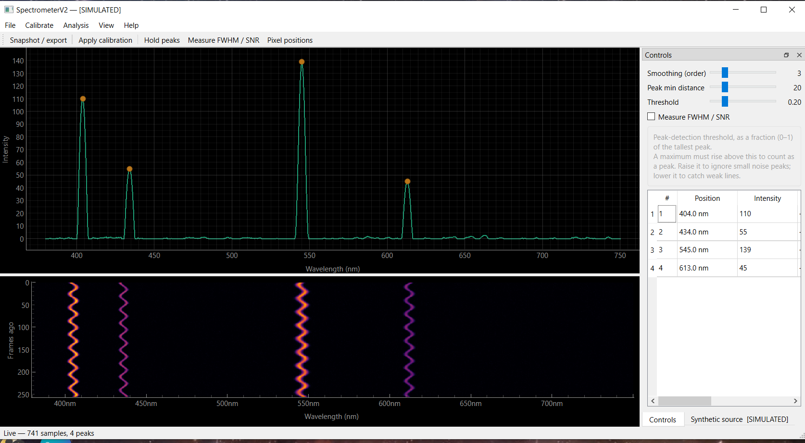
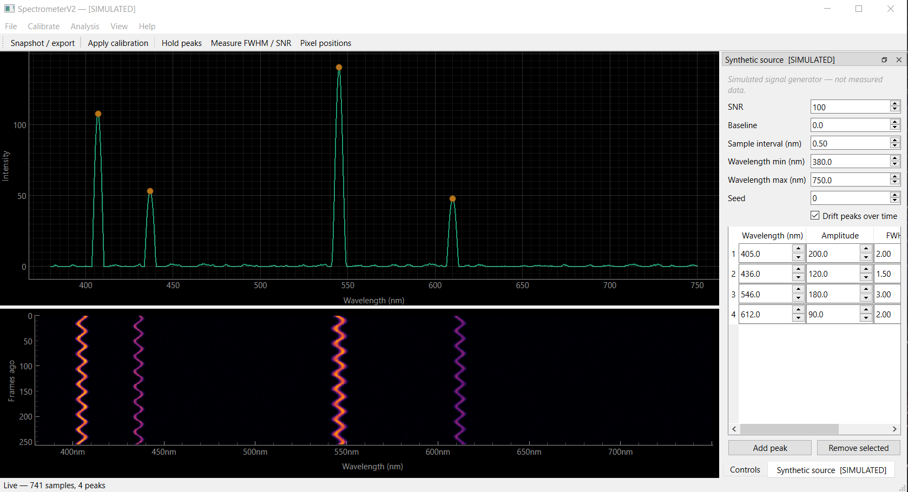
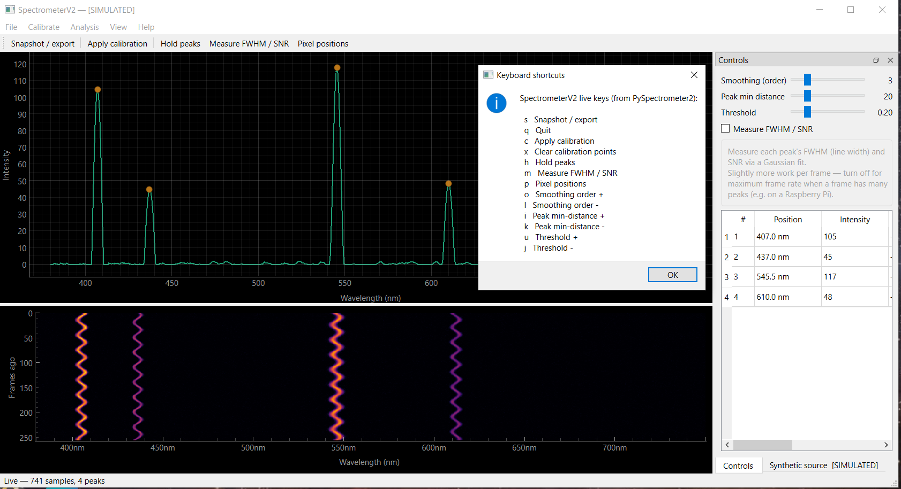

# SpectrometerV2

Calibrated, tested software for DIY diffraction spectrometers, on Raspberry Pi,
Windows, and Linux. A ground-up modernization of Les Wright's PySpectrometer2.

> *Think like a physicist. Build like an engineer.*



## What it does

- **Live spectrum and waterfall** with automatic peak detection and a peak
  table you can read wavelengths straight off.
- **Wavelength calibration** from known reference lines (click peaks to pick
  points), with the calibration recorded alongside every measurement.
- **Line analysis:** Savitzky-Golay smoothing, Gaussian peak fits, FWHM, and SNR.
- **Built-in signal generator**, so you can learn the software, tune settings,
  and check the analysis against known answers with no hardware at all.
- **Logging you can query:** CSV by default, plus optional SQLite and InfluxDB
  (for Grafana).
- **Same keys as PySpectrometer2**, and its scientific results are preserved,
  pinned by golden regression tests.
- **328 automated tests.** Windows, Linux, and Raspberry Pi are all first-class.

## Try it in two minutes, no hardware needed

Clone the repository (or download the latest zip from
[Releases](https://github.com/fsd61/SpectrometerV2/releases) and unzip it), then:

```bash
git clone https://github.com/fsd61/SpectrometerV2.git
cd SpectrometerV2
python -m venv .venv            # python3 on Linux
# Windows: .venv\Scripts\activate      Linux: source .venv/bin/activate
pip install -e ".[gui]"
spectrometerv2 --set camera.backend=synthetic gui
```

The window opens in **[SIMULATED]** mode with a reference spectrum. Use the
**Synthetic source** tab to add, move, and reshape peaks, change the noise
level, or let the peaks drift, and watch the analysis follow.

<p>
  
  
</p>

Ready for a real camera? [INSTALL.md](INSTALL.md) covers USB cameras, the
Raspberry Pi camera, and platform-specific setup.

## Design

SpectrometerV2 is built around **one platform-neutral
scientific core**, with all OS- and camera-hardware specifics behind adapters.
Linux, Windows, and Raspberry Pi are equal first-class platforms. See the
engineering documents in `Docs/` for the governing Requirements,
Architecture & Design, and Migration Plan.

## Acknowledgements

SpectrometerV2 builds on the original **PySpectrometer2** by **Les Wright**,
whose proven spectral algorithms are preserved as the scientific baseline (see
`Original_Pyspectrometer2/`, tag `baseline-v1.0`). The scientific behavior is
preserved and golden-tested, while the implementation is essentially new — see
`ATTRIBUTION.md` for the full provenance and `NOTICE` for required credits.

## Repository layout

```
src/                  Application sources (flat layout — no wrapper package)
  app/          startup, CLI, orchestration
  config/       INI schema and validation            (CFG-*)
  platforms/    platform-specific services            (PLAT-*)
  cameras/      camera contract + adapters (USB, Pi)   (HW-*)
  acquisition/  frame capture + acquisition metadata
  processing/   spectrum extraction + shared Spectrum object
  calibration/  wavelength calibration
  analysis/     peak detection, fitting, FWHM, SNR
  synthetic/    reproducible synthetic spectra         (SYN-*)
  data/         persistence: locked core schema, CSV / SQLite / InfluxDB
                sinks, user field manifest             (DATA-*)
  ui/           GUI + plotting
  errors.py         application exception hierarchy
  logging_setup.py  structured rotating logging        (LOG-*)
config/         config.ini (+ alternates)              (externalized config)
tests/          unit / integration / regression / hardware / platform
Docs/           engineering documents + reference papers
Original_Pyspectrometer2/   Preserved upstream baseline (Les Wright)
```

## Status

Working today: configuration and logging services (CLI), and an extracted,
golden-verified scientific core — spectrum extraction, wavelength calibration,
Savitzky–Golay smoothing, peak detection, Gaussian line fitting, FWHM, and SNR —
with an end-to-end analysis pipeline, plus a reproducible synthetic spectrum
generator (Phase 4). Camera adapters (USB, Raspberry Pi, and synthetic) sit
behind a common contract with an acquisition service (Phase 5), and the
application runs headless via a CLI (run / generate-synthetic / analyze /
test-camera / verify-hardware / check-calibration), saving results through a
pluggable persistence sink (Phase 6).

Persistence writes CSV by default and can additionally tee to **SQLite** (the
queryable system of record: spectrum arrays, calibration records, full
provenance) and **InfluxDB** (scalar telemetry for Grafana). Both are off by
default. The core schema is locked — capture identity, backend provenance and
calibration fingerprint are fixed and cannot be overridden — while anything else
you want to collect is declared in a small INI manifest that applies to both
stores at once. See `config/user_fields.ini.example`.

A golden + ground-truth regression suite (`tests/regression/`) pins the baseline
behavior and proves the extracted modules equivalent (Phases 1, 3, 4, 5, 6 & 8). Test suite:
328 tests, installable via `pip install -e .`.

## Usage

```bash
pip install -e .[dev]

# One-time: create your documented config (config/config.ini)
spectrometerv2 init-config

# From then on it's auto-loaded — no --config needed
spectrometerv2 validate-config
spectrometerv2 describe-config          # print the documented schema

# Override any value for a single run (CFG-006)
spectrometerv2 --set synthetic.seed=7 validate-config

# Run hardware-free and save a plot
spectrometerv2 --set camera.backend=synthetic --plot generate-synthetic
spectrometerv2 --frames 60 stream        # synthetic waterfall

# Run from source without installing
PYTHONPATH=src python -m app validate-config

# Run the test suite
pytest
```

## Configuration

Everything lives in the project directory, so the whole thing is self-contained
and movable. Configuration is a single INI file in the project's `config/`
folder. Run `spectrometerv2 init-config` to write a fully-commented
`config/config.ini` (generated from the schema, so every key is documented). It's
auto-discovered at startup — resolved from the project root, so it works from any
subdirectory — and `--config PATH` overrides it. Keep alternate complete configs
alongside it (e.g. `config/lab.ini`) and select one with `--config config/lab.ini`.
`config/config.ini.example` is a browsable copy.

## Feedback

Tried it? Feedback of any kind is welcome: post in
[Discussions](https://github.com/fsd61/SpectrometerV2/discussions), or open an
[issue](https://github.com/fsd61/SpectrometerV2/issues) if something breaks.

## License

SpectrometerV2 is licensed under the **Apache License 2.0** (see `LICENSE`),
the same license as the upstream PySpectrometer2. Attribution notices are in
`NOTICE`; provenance and credit are detailed in `ATTRIBUTION.md`.
