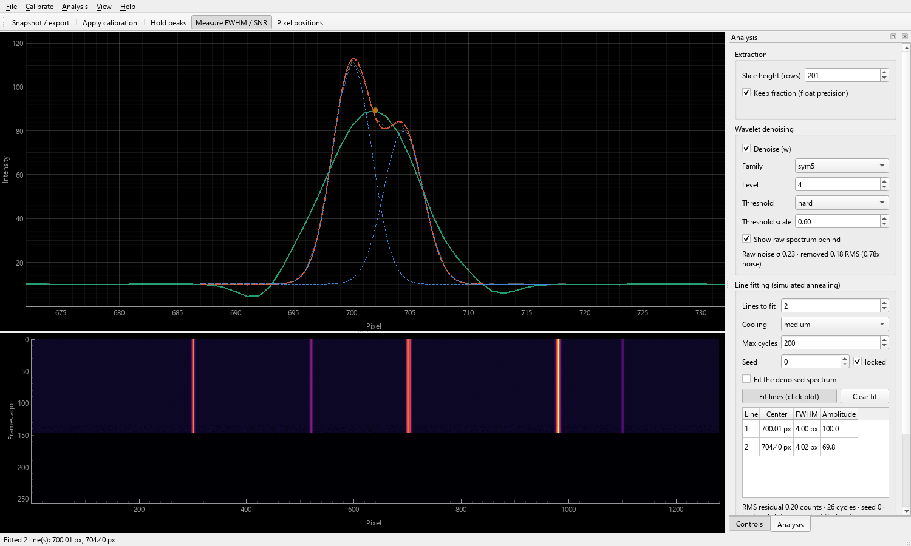

# SpectrometerV2

Calibrated, tested software for DIY diffraction spectrometers, on Raspberry Pi,
Windows, and Linux. A ground-up modernization of Les Wright's PySpectrometer2.

> *Think like a physicist. Build like an engineer.*


## What it does

- **Live spectrum and waterfall** with automatic peak detection and a peak
  table you can read wavelengths straight off.
- **Wavelength calibration** from known reference lines (click peaks to pick
  points), with the calibration recorded alongside every measurement.
- **Line analysis:** Savitzky-Golay smoothing, Gaussian peak fits, FWHM, and SNR.
- **More signal from the same frame:** average the whole slit image instead of
  3 rows, for up to about 10x the signal-to-noise of PySpectrometer2
  ([details](#more-signal-from-the-same-frame)).
- **Overlapping lines split, sub-pixel line centers:** simulated annealing line
  fitting in the GUI, and calibrations built from fitted centers rather than
  whole pixels ([details](#simulated-annealing-line-fitting)).
- **Wavelet denoising** as a switchable stage, with its effect shown against the
  raw spectrum ([details](#wavelet-denoising)).
- **Built-in signal generator**, so you can learn the software, tune settings,
  and check the analysis against known answers with no hardware at all.
- **Logging you can query:** CSV by default, plus optional SQLite and InfluxDB
  (for Grafana).
- **Same keys as PySpectrometer2**, and its scientific results are preserved,
  pinned by golden regression tests.
- **401 automated tests.** Windows, Linux, and Raspberry Pi are all first-class.

## Try it in two minutes, no hardware needed

Clone the repository (or download the latest zip from
[Releases](https://github.com/fsd61/SpectrometerV2/releases) and unzip it), then:

```bash
git clone https://github.com/fsd61/SpectrometerV2.git
cd SpectrometerV2
python -m venv .venv            # python3 on Linux
# Windows: .venv\Scripts\activate      Linux: source .venv/bin/activate
pip install -e ".[gui]"
spectrometerv2 --set camera.backend=synthetic gui
```

The window opens in **[SIMULATED]** mode with a reference spectrum. Use the
**Synthetic source** tab to add, move, and reshape peaks, change the noise
level, or let the peaks drift, and watch the analysis follow.

To try the extraction band and line fitting on simulated *camera frames*
(an OV9281-like 1280x800 sensor with realistic noise and an argon-like doublet
at 700/704 px), start it with `--set camera.backend=synthetic-camera` instead.

<p>
  
  
</p>

Ready for a real camera? [INSTALL.md](INSTALL.md) covers USB cameras, the
Raspberry Pi camera, and platform-specific setup.

## What sets it apart

SpectrometerV2 keeps PySpectrometer2's scientific results exactly, pinned by
regression tests, and builds a measurement instrument on top of them:

|                                  | PySpectrometer2              | SpectrometerV2 |
|----------------------------------|------------------------------|----------------|
| Rows of the slit image per sample | 3, rounded to whole counts  | Adjustable up to the whole slit image, fractional: about 11x the signal-to-noise in simulation ([below](#more-signal-from-the-same-frame)) |
| Line shape                       | Peak position only           | Gaussian fit, FWHM, and signal-to-noise for every line |
| Overlapping lines                | Seen as one line             | Split by simulated annealing (DiGennaro & Cowburn, 1992) with a least-squares polish, from the GUI ([below](#simulated-annealing-line-fitting)) |
| Calibration line centers         | Whole pixels                 | Sub-pixel fitted centers: 38-97% lower calibration error in simulation ([below](#sub-pixel-calibration)) |
| Noise handling                   | Smoothing only               | Switchable wavelet denoising, with line widths and SNR always measured on the raw data ([below](#wavelet-denoising)) |
| Checking against known answers   | None                         | Built-in signal generator and simulated camera; 401 automated tests |
| Calibration provenance           | None                         | Calibration fingerprint stored with every measurement; simulated data can never pass as real |
| Data                             | CSV snapshots                | CSV, SQLite with full provenance, InfluxDB for Grafana |
| Platforms                        | Raspberry Pi and Linux       | Raspberry Pi, Windows, and Linux |

### More signal from the same frame

PySpectrometer2 builds each spectrum from 3 rows of the camera image, but the
slit image is usually hundreds of rows tall. SpectrometerV2 can average as many
rows as the slit image covers. Random noise falls as 1/sqrt(rows), so the
signal-to-noise ratio rises with the band:

| Rows averaged          | Signal-to-noise vs PySpectrometer2 |
|-----------------------:|-----------------------------------:|
| 3 (PySpectrometer2)    | 1x                                 |
| 25                     | 2.9x                               |
| 81                     | 5.2x                               |
| 401                    | 11.4x                              |

*Simulated: 1280x800 8-bit frames, 3 counts of per-pixel noise, a 401-row slit
image. Re-run with your own assumptions: `python scripts/measure_slice_height.py --help`.*

```ini
[processing]
# Odd; keep the whole band inside the bright slit image.
slice_height = 301
# Keep the fraction; truncating to whole counts would cap the gain near 2.6x.
slice_precision = float
```

A taller band does not improve resolution. If the slit image is tilted relative
to the pixel rows, lines broaden as the band grows (about 6% for a 2-pixel tilt
across 401 rows). The default stays at PySpectrometer2's 3 rows.

### Simulated annealing line fitting



Two lines about one line-width apart, like the Ar I 810.37 / 811.53 nm pair at
0.266 nm/px, look like a single peak to peak detection and to the smoothed
trace. In the **Analysis** panel, set *Lines to fit* to 2, press **f**, and
click the blend: the fit runs in the background and reports each line's center,
FWHM, and amplitude, in nm once the instrument is calibrated.

The fit uses simulated annealing, adapted from DiGennaro & Cowburn, "Parametric
Estimation of Time-Domain NMR Signals Using Simulated Annealing", *J. Magn.
Reson.* 96, 582–588 (1992), to find the lines, then a Levenberg-Marquardt polish
to pin their centers down. Each does a job the other cannot. Simulated, on a
doublet 4.4 px apart with 2 counts of noise, 20 trials each:

| | Annealing alone | Polish alone | Annealing + polish |
|---|---:|---:|---:|
| Mean center error, starting on the blend | 0.25 px | 0.07 px | 0.07 px |
| Doublet recovered, starting 4 px off | 14 in 20 | 1 in 20 | 16 in 20 |

The random seed is shown, locked by default, and recorded with every fit, and
the panel reports which path produced the best fit. Primer:
[Docs/simulated_annealing_primer.pdf](Docs/simulated_annealing_primer.pdf).

### Sub-pixel calibration

PySpectrometer2 calibrates from whole-pixel positions, so every reference line
can be off by up to half a pixel. With **Calibrate ▸ Use fitted line centers**,
each picked line is fitted first, and a doublet's two halves are fitted
together. **Calibrate ▸ Compare centroid methods** shows the effect on your own
lines: each line's wavelength is predicted from a calibration fitted to the
others, once with the picks and once with fitted centers. Simulated, with six
lines including the doublet (leave-one-out RMS error, mean of 8 frames):

| Extraction             | Whole-pixel picks | Fitted centers |
|------------------------|------------------:|---------------:|
| 3 rows (PySpectrometer2) | 0.157 nm        | 0.097 nm       |
| 25 rows, float         | 0.157 nm          | 0.023 nm       |
| 101 rows, float        | 0.157 nm          | 0.010 nm       |
| 301 rows, float        | 0.157 nm          | 0.005 nm       |

The taller extraction band and fitted centers compound: the band raises the
signal-to-noise, and the fit turns it into wavelength accuracy.

### Wavelet denoising

A switchable stage (**w**) ahead of smoothing and peak detection, using
cycle-spun wavelet thresholding. It reads the raw spectrum and never replaces
it: snapshots stay raw, and line widths and SNR are always measured on the raw
data, because a denoised trace has artificially low noise. The panel shows the
raw spectrum behind the processed one, and how much the denoiser removed
compared with the measured noise.

The defaults are deliberately gentler than the textbook threshold. Simulated,
4-px-wide lines with 3 counts of noise:

| Threshold | Baseline noise reduced | Dim line height kept |
|---|---:|---:|
| Universal, soft (textbook) | 3.8x | 43% |
| 0.6x universal, hard (default) | 2.5x | 93% |

Denoising cleans the display and peak detection. It does not make fitted line
centers more precise: a fit to the raw data already uses all the information,
so the line fit works on the raw spectrum unless you choose otherwise. Primer:
[Docs/wavelet_transforms_primer.pdf](Docs/wavelet_transforms_primer.pdf).

## Design

SpectrometerV2 is built around **one platform-neutral
scientific core**, with all OS- and camera-hardware specifics behind adapters.
Linux, Windows, and Raspberry Pi are equal first-class platforms. See the
engineering documents in `Docs/` for the governing Requirements,
Architecture & Design, and Migration Plan.

## Acknowledgements

SpectrometerV2 builds on the original **PySpectrometer2** by **Les Wright**,
whose proven spectral algorithms are preserved as the scientific baseline (see
`Original_Pyspectrometer2/`, tag `baseline-v1.0`). The scientific behavior is
preserved and golden-tested, while the implementation is essentially new — see
`ATTRIBUTION.md` for the full provenance and `NOTICE` for required credits.

## Repository layout

```
src/                  Application sources (flat layout — no wrapper package)
  app/          startup, CLI, orchestration
  config/       INI schema and validation            (CFG-*)
  platforms/    platform-specific services            (PLAT-*)
  cameras/      camera contract + adapters (USB, Pi)   (HW-*)
  acquisition/  frame capture + acquisition metadata
  processing/   spectrum extraction + shared Spectrum object
  calibration/  wavelength calibration
  analysis/     peak detection, fitting, FWHM, SNR
  synthetic/    reproducible synthetic spectra         (SYN-*)
  data/         persistence: locked core schema, CSV / SQLite / InfluxDB
                sinks, user field manifest             (DATA-*)
  ui/           GUI + plotting
  errors.py         application exception hierarchy
  logging_setup.py  structured rotating logging        (LOG-*)
config/         config.ini (+ alternates)              (externalized config)
tests/          unit / integration / regression / hardware / platform
Docs/           engineering documents + reference papers
Original_Pyspectrometer2/   Preserved upstream baseline (Les Wright)
```

## Status

Working today: configuration and logging services (CLI), and an extracted,
golden-verified scientific core — spectrum extraction, wavelength calibration,
Savitzky–Golay smoothing, peak detection, Gaussian line fitting, FWHM, and SNR —
with an end-to-end analysis pipeline, plus a reproducible synthetic spectrum
generator (Phase 4). Camera adapters (USB, Raspberry Pi, and synthetic) sit
behind a common contract with an acquisition service (Phase 5), and the
application runs headless via a CLI (run / generate-synthetic / analyze /
test-camera / verify-hardware / check-calibration), saving results through a
pluggable persistence sink (Phase 6).

Persistence writes CSV by default and can additionally tee to **SQLite** (the
queryable system of record: spectrum arrays, calibration records, full
provenance) and **InfluxDB** (scalar telemetry for Grafana). Both are off by
default. The core schema is locked — capture identity, backend provenance and
calibration fingerprint are fixed and cannot be overridden — while anything else
you want to collect is declared in a small INI manifest that applies to both
stores at once. See `config/user_fields.ini.example`.

The PySide6 GUI (Phase 7) adds the live view, waterfall, click-to-calibrate, and
the Analysis panel: extraction band, wavelet denoising, simulated-annealing line
fitting, and the sub-pixel calibration check.

A golden + ground-truth regression suite (`tests/regression/`) pins the baseline
behavior and proves the extracted modules equivalent (Phases 1, 3, 4, 5, 6 & 8). Test suite:
401 tests, installable via `pip install -e .`.

## Usage

```bash
pip install -e .[dev]

# One-time: create your documented config (config/config.ini)
spectrometerv2 init-config

# From then on it's auto-loaded — no --config needed
spectrometerv2 validate-config
spectrometerv2 describe-config          # print the documented schema

# Override any value for a single run (CFG-006)
spectrometerv2 --set synthetic.seed=7 validate-config

# Run hardware-free and save a plot
spectrometerv2 --set camera.backend=synthetic --plot generate-synthetic
spectrometerv2 --frames 60 stream        # synthetic waterfall

# Run from source without installing
PYTHONPATH=src python -m app validate-config

# Run the test suite
pytest
```

## Configuration

Everything lives in the project directory, so the whole thing is self-contained
and movable. Configuration is a single INI file in the project's `config/`
folder. Run `spectrometerv2 init-config` to write a fully-commented
`config/config.ini` (generated from the schema, so every key is documented). It's
auto-discovered at startup — resolved from the project root, so it works from any
subdirectory — and `--config PATH` overrides it. Keep alternate complete configs
alongside it (e.g. `config/lab.ini`) and select one with `--config config/lab.ini`.
`config/config.ini.example` is a browsable copy.

## Feedback

Tried it? Feedback of any kind is welcome: post in
[Discussions](https://github.com/fsd61/SpectrometerV2/discussions), or open an
[issue](https://github.com/fsd61/SpectrometerV2/issues) if something breaks.

## License

SpectrometerV2 is licensed under the **Apache License 2.0** (see `LICENSE`),
the same license as the upstream PySpectrometer2. Attribution notices are in
`NOTICE`; provenance and credit are detailed in `ATTRIBUTION.md`.
